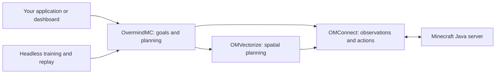

# OvermindMC

**Current release: Version Arthas `1.0.0-Arthas-dev.2` · Created by y9kudo · MIT.**

[Download OvermindMC and OMConnect](https://github.com/y9kudo/mckudo_core/releases/tag/v1.0.0-Arthas-dev.2) · [Release notes and installation](docs/releases/1.0.0-Arthas-dev.2.md).

## What is in this release

- **OvermindMC** plans goals, recipes, survival tasks and learning for Minecraft Java agents. **OMConnect** executes actions through the Java protocol; **OMVectorize** plans movement and spatial actions.
- An optional [C computation layer](docs/NATIVE-COMPUTE.md) handles bounded ground search, packet framing and explicit numerical inference. The JavaScript APIs and adapters remain available.
- Expedition reports retain learning evidence, placement ownership, heartbeats and interrupted segments. Cave reconnaissance uses supported descents and recovery routes back toward surface resources. [Full campaign instructions](docs/FULL-EXPEDITION.md).
- PPO, discrete SAC, a physical headless environment and a live RL control bridge are available for experimentation. [Learning and simulation guide](docs/RL-PHYSICS-AND-CONNECT.md).

The release passed **561 automated tests** locally, including the compiled C backend; its GitHub Actions checks also passed on Windows and Linux. An autonomous run from an empty inventory through an own Ender Dragon victory is still unverified. [Validation evidence](docs/results/native-expedition-2026-10-14.md) · [Version support](docs/VERSION-API.md) · [Current release notes](docs/releases/1.0.0-Arthas-dev.2.md).

## What the components do

**OvermindMC** is the brain: goals, resource classes, recipe planning, survival policies, learning, experience, cooperation and persistent memory. It is a library for building agents, not a single Minecraft bot.

**OMConnect** is the independent Java client: server connection and authentication, authoritative world and inventory observations, player physics, containers, equipment and action execution. It uses Java protocol libraries and does not require Mineflayer.

**OMVectorize** handles spatial calculations: ground routes, swimming, body clearance and elytra trajectories. Ground planning includes diagonal movement, supported jumps and descents, controlled excavation and bridges. Execution rechecks terrain and protected regions before editing blocks.



## Start without writing an agent

Install Node.js 24, open this checkout in VS Code, and run these commands in its terminal:

```powershell
npm.cmd ci
npm.cmd test
npm.cmd run test:types
npm.cmd run dashboard
```

The dashboard binds to the local computer. It shows each agent's inventory, health, goals, task blocks, observed world and diagnostic timings. Controls require the local session token. Unknown chunks are displayed as unknown rather than invented terrain. [Dashboard guide](docs/DASHBOARD.md).

To run a bounded real-world test against your offline Java 1.21.1 server at `127.0.0.1:25565`:

```powershell
node examples/curriculum-live.js --tier=stone --name=AtlasTrial --minutes=8
```

Use a new nickname for an empty-inventory test. The launcher checks Survival mode, executes the six stages and saves a report under `data/arthas-live/`. It does not grant items or teleport the agent. [Curriculum guide](docs/ARTHAS-CURRICULUM.md).

## Use the library in your own application

Download `overmindmc-1.0.0-Arthas-dev.2.tgz` from the [current release](https://github.com/y9kudo/mckudo_core/releases/tag/v1.0.0-Arthas-dev.2). In your application's folder, install the downloaded archive:

```powershell
npm.cmd install .\overmindmc-1.0.0-Arthas-dev.2.tgz
```

The independent client is available as `omconnect-1.0.0-Arthas-dev.2.tgz` in the same release. These archives are published on GitHub; installation resolves npm dependencies, and neither package is published to the npm registry.

Create `index.js`, with `"type": "module"` in your application's `package.json`:

```js
import { createMinecraftAgent } from 'overmindmc';

const agent = createMinecraftAgent({
  name: 'Atlas',
  worldId: 'my-local-survival-world',
  connection: {
    host: '127.0.0.1', port: 25565,
    version: '1.21.1', auth: 'offline'
  }
});

try {
  await agent.get('#logs', 4);       // any usable nearby wood species
  await agent.craft('crafting_table', 1);
  await agent.craft('wooden_pickaxe', 1);
  await agent.get('cobblestone', 8);
  await agent.craft('furnace', 1);
} finally {
  await agent.close();
}
```

Keep `worldId` stable for the same world; change it for a new world. The core chooses actions and checks the resulting inventory. Acacia, birch and other members of `#logs` can satisfy the wood goal; recipes are selected for the connected registry. [Beginner instructions](docs/GETTING-STARTED.md) · [Simple agent API](docs/SIMPLE-AGENT.md) · [Scenarios](docs/SCENARIOS.md).

## Simple declarative missions

```js
import { defineMission } from 'overmindmc';

const mission = defineMission([
  { get: '#logs', count: 4 },
  { craft: 'crafting_table', count: 1 },
  { craft: 'wooden_pickaxe', count: 1 },
  { get: 'cobblestone', count: 8 },
  { craft: 'furnace', count: 1 }
]);
await agent.run(mission);
```

You can also store scenarios and task queues as JSON. Conditions refer to observed facts; a planned effect is not treated as a successful action. [JSON configuration](docs/JSON.md) · [Missions](docs/MISSIONS-AND-BRIDGES.md) · [Task workflows](docs/WORKFLOWS.md).

## Learning and physical simulation

```powershell
node examples/train-physical.js --algorithm=ppo --batches=400 --count=32
node examples/train-physical.js --algorithm=sac --batches=600 --count=32
node examples/rl-connect-live.js --name=ArthasRL
```

Double DQN, PPO and discrete SAC run on CPU. Physical environments share OMConnect's 50 ms physics step and model collision, liquids, falls and bounded zombie behavior. Worker pools support 128 independent environments without opening Minecraft windows. A skill-level simulator is also available for resource progression.

The low-level RL bridge executes a compatible 18-feature, 9-action policy through OMConnect. It checks health, loaded support, hazards, projected motion and legal attack targets. Training and evaluation remain explicit. [RL, physics and live transfer](docs/RL-PHYSICS-AND-CONNECT.md) · [v1 intelligence API](docs/V1-INTELLIGENCE.md).

HTN and MCTS planners, a goal stack, rewards, BC/offline replay, SQLite world hints, telemetry and watchdogs are available through `overmindmc/intelligence`. LLM providers are optional; local planning and training do not require a paid service.

## Minecraft versions and integrations

The [version API](docs/VERSION-API.md) exposes catalog, transport, native-action and live-verification status separately. All **30 installed transport families** pass movement codec round trips. Native high-level action profiles currently cover **1.21/1.21.1**, with live evidence on **1.21.1**. A codec or recipe catalog alone does not prove full agent support on another release. Additional profiles can be registered explicitly; the separately supplied 26.3 profile is experimental.

The optional Mineflayer adapter lets existing applications use OvermindMC's planning layer. Mineflayer is a development dependency for interoperability tests and is not required by the native production path. [Adapter API](docs/API.md).

Forge, NeoForge and Fabric integrations use the bridge contract and explicit catalogs/machine recipes. Register modded mechanisms through their executor rather than sending vanilla clicks to an unknown GUI. [Mod integration](docs/MODS.md) · [Machine recipes](docs/MACHINE-RECIPES.md).

## Other capabilities

- Resource catalogs, multiple block classes, recipe graphs and lazy connected-world recipe books.
- Equipment and tool selection, food and sleep policies, protection and tactical combat.
- Nether portals, fortress/resource search, barter planning and End expedition policies.
- Containers, gifts and negotiated exchanges; physical schematic construction in Creative and Survival.
- Cooperative agents, shared observations, claims, role assignment and persistent world hints.

[Automation](docs/AUTOMATION.md) · [Navigation and protected builds](docs/BUILDINGS-AND-PVP.md) · [Nether](docs/NETHER.md) · [Schematics](docs/SCHEMATICS.md) · [Expeditions](docs/FULL-EXPEDITION.md).

## Validate a change

```powershell
npm.cmd test
npm.cmd run test:types
npm.cmd run release:check
npm.cmd run test:package -- --offline
```

The package test installs packed archives into a separate consumer. Its offline mode requires dependencies already present in the npm cache. The release check validates packaged imports, documentation links, metadata and exclusion of local runtime files. Live test reports belong in `data/`; publish curated evidence without account caches, world files or tokens.

[Contribution guide](CONTRIBUTING.md) · [Readiness criteria](docs/V1-READINESS.md) · [Roadmap](ROADMAP.md) · [License](LICENSE).
