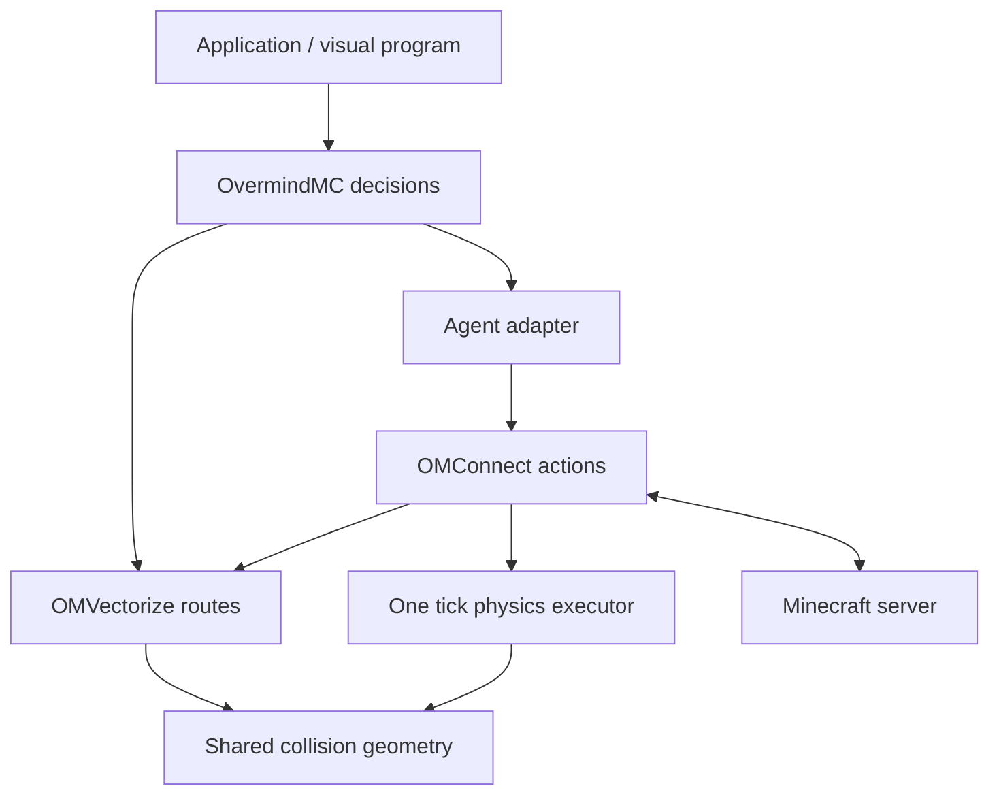

# OvermindMC V2 architecture · Arthas beta2

V2 is an incremental architecture migration. It preserves the beta1 JavaScript/TypeScript entry points and keeps working physics, protocol codecs, symbolic planning, learning and visual-program contracts. It does not declare a completed autonomous Dragon campaign or a comparative navigation result.

## Audit and ownership

| Boundary | Existing implementation | V2 responsibility |
| --- | --- | --- |
| Goals and decisions | `src/core.js`, `minecraft-brain.js`, `scenario.js`, `agent-program.js`, `task-queue.js` | Arbitrate goals and verify completion from observations |
| Symbolic and learned planning | `src/planner.js`, `planning/`, `neural-planning.js`, `neural-navigation.js` | Rank admissible plans; preserve deterministic fallbacks |
| World and experience memory | `src/spatial-memory.js`, `platform/world-store.js`, `agent-memory.js`, `file-memory.js` | Versioned, scoped hints and checkpoints |
| Protocol and actions | `packages/omconnect/src/client.js`, `actions.js`, `inventory.js`, `crafting.js` | Own one character's connection, authoritative observations and action execution |
| Geometry and routes | `navigation.js`, `vectorize.js`, `movement.js`, `physics.js`, `environment.js` | Share shape semantics, bound search work and reconcile movement with observations |
| Native acceleration | `native/om_kernel.c`, `node_binding.c`, `index.js` | Optional verified kernels with JavaScript fallback |
| Interfaces | `adapters/`, public `.d.ts` files, `src/dashboard*` | Preserve application contracts and expose diagnostics |

The dependency direction is **application → OvermindMC decisions → OMVectorize calculations → OMConnect actions → server observations**. The client can use OMVectorize without importing the decision kernel. Physics remains the only producer of predicted character movement; planners never teleport characters or manufacture inventory.

The initial static inventory covered 358 source, contract, native, test and documentation files (25,667 lines, including manifests). The generated import inventory and raw profiling output remain local QA data. Before V2 changes, nine repeated searches measured p50/p95 of 3.09/6.17 ms on a 96-block flat route and 2.87/3.26 ms on a 48-block forest fixture, on Windows/Node.js 24.19.0. These are computation baselines, not gameplay completion times.

## Findings before migration

- Local ground A* is bounded and cooperatively scheduled. Multi-goal search and route leases already eliminate repeated approach searches.
- Ground planning primarily uses full-block, integer-height states. Swimming and flight use a separate body-volume test, while physics enumerates collision shapes independently. Partial-block execution must not be claimed from a planner-only test.
- Navigation execution uses a 128-block search radius. There is no durable regional route graph or incremental regional shortest-path state.
- A global world revision is too broad for cached routes. Existing section read views provide a better invalidation boundary; serialized routes must still be checked against current blocks.
- Action failures have typed codes, but retries and translations are spread across the movement controller and kernel policies. A shared bounded recovery contract is needed.
- Existing motion applies acceleration, friction and smooth look updates. Multi-tick prediction needs to reuse this implementation rather than introduce a competing physics engine.
- Persistent SQLite storage, DQN/PPO/SAC, HTN/MCTS, worker scheduling, replay primitives and visual programs already exist. Replacing them without a measured defect is outside Phase A.
- The live engineering campaign exposed loss-of-equipment recovery, inaccessible threats and a rare equipment-packet decode failure. These remain explicit regression targets; no unobserved cause is assumed.

## Phase A contracts

1. **Traversal:** one collision-shape/body contract shared by volume checks and physical collision queries. Unknown cells block passage. Pose dimensions and support heights are explicit.
2. **Regional planning:** bounded observed regional edges and an incremental shortest-path solver. Regional edges are hints; the local A* must validate every executable segment.
3. **Navigation sessions:** scoped, bounded local route reuse; long goals are split into validated segments. Each request has a node budget, cancellation and an explicit partial result.
4. **Motion:** short predictions use the existing `stepPhysics` tick function. No second physical executor or additional packet clock is introduced.
5. **Recovery:** canonical failure codes, bounded retry decisions and explicit terminal/blocked states. Temporary obstacles and server corrections do not become permanent terrain facts.
6. **Benchmarks:** deterministic offline fixtures measure computation and geometry work. Their results are separate from movement success on a real server.

## Compatibility and memory

Existing core schema versions, JSON visual programs and beta1 checkpoints remain readable. New navigation state lives in a separate, scoped versioned envelope. Scope includes server, world, dimension and Minecraft version. Imported routes are advisory and require live validation before reuse. Unknown/new schema versions fail explicitly; no migration mutates a caller's input.

Public APIs are additive. Existing `planRoute`, `planGround`, swimming/flight APIs and deprecated aliases remain available. Native ground search remains optional; capabilities it does not implement fall back to JavaScript.

## Delivery sequence and acceptance

- **A:** geometry, regional/incremental route planning, bounded navigation sessions, motion predictions, recovery and offline benchmarks.
- **B:** World Atlas, frontier exploration and contextual navigation learning.
- **C:** unified cognitive decisions, plan repair and controlled learning evaluation.
- **D:** transactional memory, task dependency graphs and autonomous recovery.
- **E:** perception, combat, cooperation, construction, mod SDK and Agent Center extensions.
- **F:** fixed-build gameplay trials and equivalent-condition comparisons.

Each implementation must document its actual integration boundary, run regressions/types/package checks and distinguish unit evidence from live gameplay evidence. Full partial-block locomotion, mixed transport execution, long-distance gameplay and the autonomous Dragon campaign require separate server trials. LPA* reuse is evaluated at the regional graph layer; no claim of a complete voxel D* Lite replacement is made.

## First beta2 increment status

| Phase A area | Implemented integration | Remaining acceptance |
| --- | --- | --- |
| Regional navigation | Directed hints, LPA* repair, bounded local segments | Large real-world route trials and segment prefetch |
| Traversal | Shared collision shapes/body volumes and support queries | Fractional-height ground states and interactive doors |
| Motion | Existing physics predictions, diagnostic samples and stalled-progress detection | Controlled parkour and predictive-control evaluation |
| Action-aware routes | Existing protected excavation and bridge transitions retained | Unified time/tool/resource cost calibration and mixed transport execution |
| Recovery | Canonical failure classes and bounded goal retries | Full cross-mission recovery integration |
| Benchmark | Deterministic planning, dynamic edits, cache, long segments and concurrent jobs | Server travel/damage/correction metrics and external comparison |

The first increment does not complete all of Phase A. Work proceeds incrementally; unfinished traversal and gameplay acceptance remain explicit while the user-requested Phase B services are added.

## Phase B increment status

| Area | Implemented integration | Remaining acceptance |
| --- | --- | --- |
| World Atlas | Bounded scoped regions, sampled coverage, anchors, directed transition history and edit invalidation | Extended multi-world retention and autonomous home/supply policies |
| Persistence | SQLite migration, bounded batched writes, JSON agent checkpoints and legacy memory import | Large-world storage/performance trials |
| Exploration | Occlusion-aware frontier gain, hazard/revisit penalties, worker ranking and shared multi-goal budgets | Information-gain calibration and mission-level time/material budgets |
| Contextual learning | Local failure/time/damage network, geometry-sensitive failure memory and label masks | Controlled unseen-world evaluations and frozen-policy comparisons |
| Integration | Default brain/manager wiring and read-only diagnostics | Unified cognitive decisions and mission-wide plan repair in Phase C |

The configured Java 1.21.1 server passed a short non-destructive movement plus on-disk atlas/reconnection check. It does not establish long-distance autonomy or improved gameplay from two transitions. [World Intelligence V2](WORLD-INTELLIGENCE-V2.md) documents APIs, migrations and current boundaries.

## Algorithm references

- [Koenig and Likhachev: incremental heuristic search](https://idm-lab.org/project-a-content.html).
- [Lifelong Planning A* publication entry](https://idm-lab.org/bib/abstracts/Koen02g.html).

The implementation uses ordinary documented search principles. No third-party navigator source is copied into the MIT codebase.
